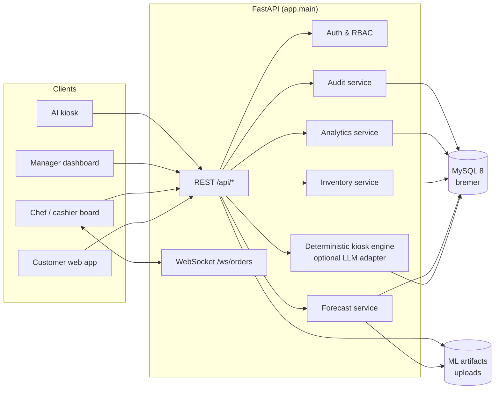
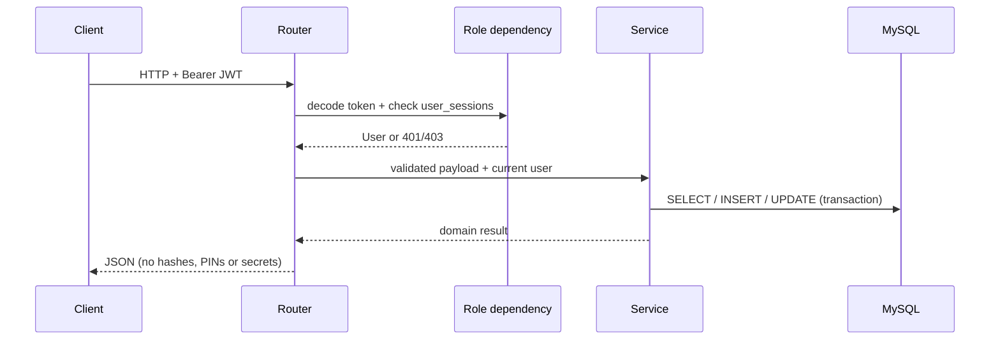
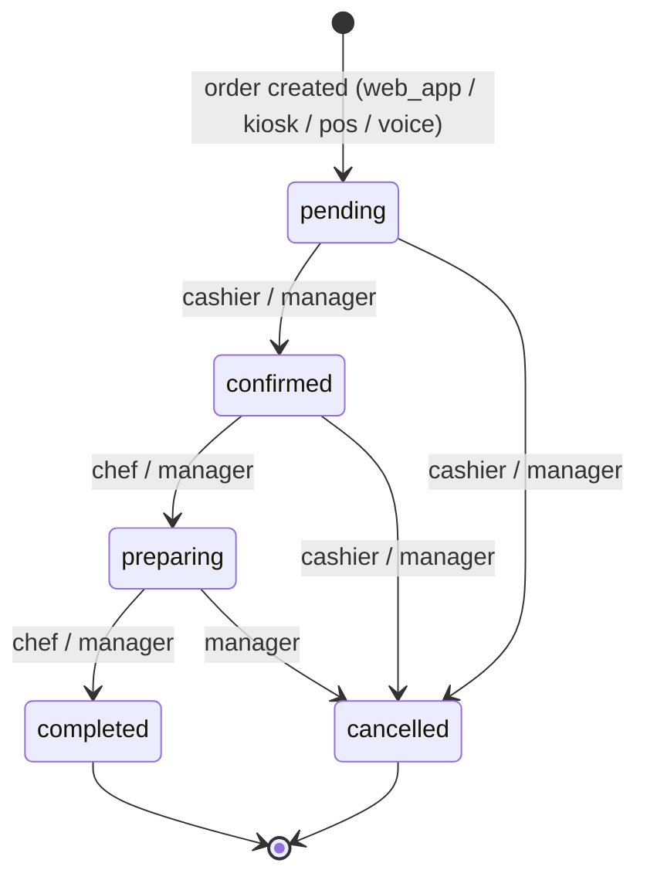
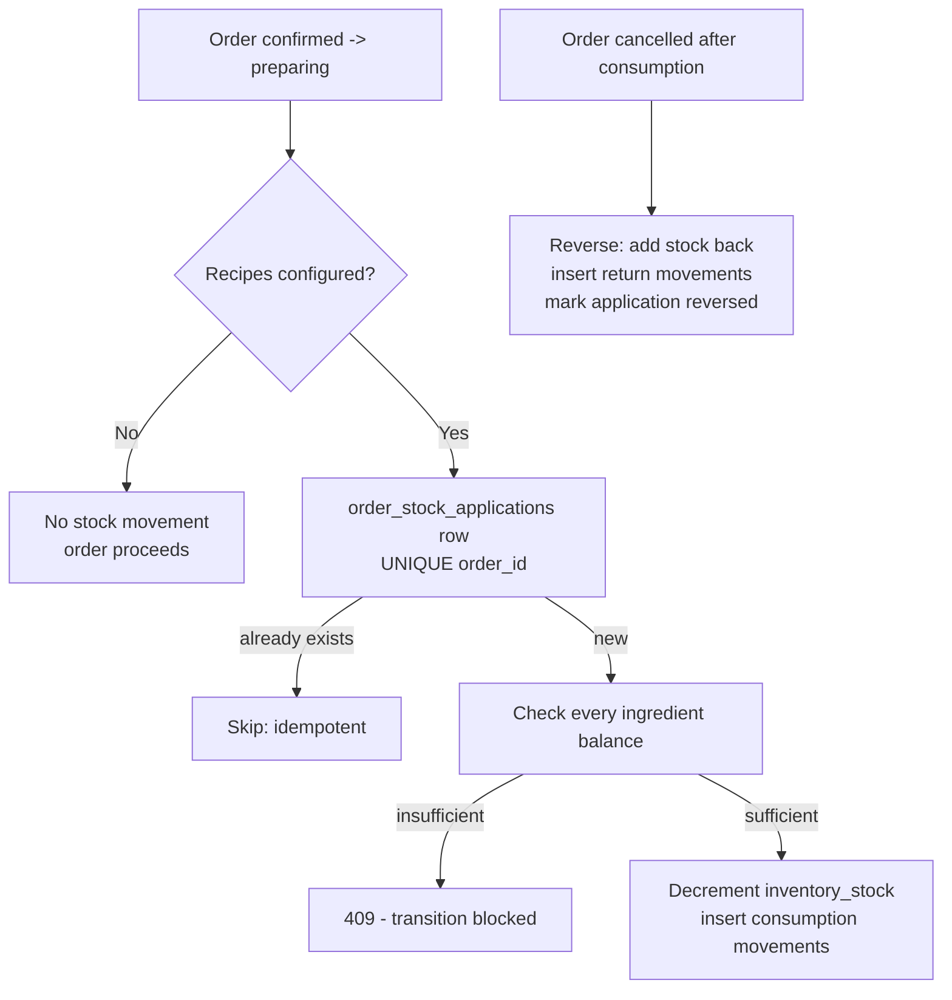
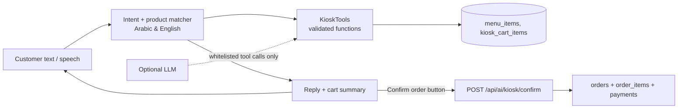
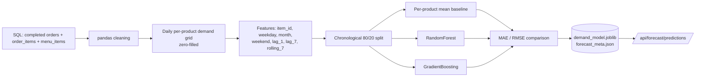
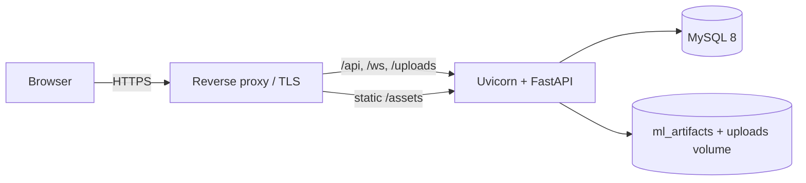

# Architecture

RestoMate AI is a single FastAPI backend, a single MySQL database and one React bundle that renders
four role-specific experiences. There is no duplicated data layer and no mock API: every screen reads
or writes the same `bremer` database.

---

## 1. System context



---

## 2. Backend layers

```
backend/app/
├── main.py                 # application factory, routers, CORS, security headers, SPA mount
├── core/
│   ├── config.py           # env-only settings (no secrets in code)
│   ├── security.py         # bcrypt / legacy SHA-256, JWT, PIN hashing, role dependencies
│   └── rate_limit.py       # in-process sliding window for login/kiosk
├── database/session.py     # SQLAlchemy engine, SessionLocal, get_db, health check
├── models/__init__.py      # 25 ORM models + relationships
├── schemas/__init__.py     # Pydantic request/response contracts
├── api/                    # thin HTTP layer: auth, menu, orders, staff, analytics, users,
│                           # inventory, suppliers, purchase orders, forecast, AI
├── services/
│   ├── orders.py           # pricing, creation, state machine, payments, serialization
│   ├── inventory.py        # stock, recipes, consumption, reversal, purchasing, recommendations
│   ├── analytics.py        # SQL aggregations and business definitions
│   ├── forecast.py         # pandas → scikit-learn → persisted artifact
│   └── audit.py            # append-only audit events
├── ai/
│   ├── matcher.py          # Arabic/English intent + product matching (no LLM needed)
│   ├── tools.py            # validated cart/menu tools, no raw SQL
│   ├── kiosk.py            # deterministic conversation state machine
│   └── llm.py              # optional OpenAI-compatible adapter, whitelisted tools only
└── realtime/manager.py     # WebSocket rooms + per-order authorization
```

Responsibilities are deliberately separated:

- **Routes** validate input, resolve the current user and call services. They do not contain business rules.
- **Services** own transactions and invariants (prices, transitions, stock, aggregation).
- **Models** are the only place that knows table structure.
- **AI** can only call `KioskTools`, which reads/writes menu and cart rows through SQLAlchemy — never raw SQL text.

---

## 3. Request lifecycle



- JWTs are HS256, carry `sub`, `role`, `jti` and expire after `ACCESS_TOKEN_EXPIRE_MINUTES`.
- Every token is tied to a `user_sessions` row; logout revokes it immediately.
- `get_current_user` rejects inactive users and the `system_ai` role.
- Role dependencies: `require_manager`, `require_staff` (chef/cashier/manager), `require_kitchen`
  (chef/manager), `require_cashier` (cashier/manager), `require_customer`.
- The database session is closed by `get_db` even on error; services commit explicitly.

### Permission matrix

| Capability | Customer | Chef | Cashier | Manager |
| --- | --- | --- | --- | --- |
| Browse menu / own profile | ✅ | ✅ | ✅ | ✅ |
| Create order for self | ✅ | — | — | — |
| View own orders | ✅ | — | — | — |
| Staff order board / all orders | — | ✅ | ✅ | ✅ |
| `pending → confirmed` | — | — | ✅ | ✅ |
| `confirmed → preparing` | ✅ | — | — | ✅ |
| `preparing → completed` | ✅ | — | — | ✅ |
| Cancel order | — | — | ✅ (pending/confirmed) | ✅ (until preparing ends) |
| Record payment | — | — | ✅ | ✅ |
| Menu / categories / staff / analytics / forecast / inventory / suppliers / purchasing / audit | — | — | — | ✅ |
| Kiosk chat (anonymous) | ✅ | ✅ | ✅ | ✅ |

`system_ai` is never issued a token: login returns 403 for that role.

---

## 4. Order lifecycle



Rules enforced in `app/services/orders.py`:

1. **Role check before graph check.** An unauthorized role gets `403` without learning whether the
   move would be valid; an authorized but impossible move (e.g. manager cancelling a completed order)
   gets `409`.
2. **Server-side pricing.** Each cart line is resolved to a current `menu_items` row. Unavailable or
   missing items are rejected. `unit_price` and `total_amount` are recalculated with
   `Decimal`/`ROUND_HALF_UP`.
3. **Snapshotting.** `order_items.item_name_snapshot` and `unit_price` preserve what was sold even if
   the menu changes later.
4. **Idempotency.** Optional `Idempotency-Key` header is stored in `orders.idempotency_key` (scoped for
   kiosk/customer), so a double submit returns the original order instead of duplicating it.
5. **History.** Every transition inserts `order_status_history` with previous/new status, actor and note.
6. **Payment state is separate.** `orders.payment_status` and the `payments` table never drive order status;
   an order can be completed while unpaid.
7. **Inventory hook.** The `confirmed → preparing` transition applies recipe consumption; cancelling a
   consumed order reverses it.

---

## 5. Inventory and purchasing



- `inventory_stock` is unique per ingredient and has `CHECK quantity >= 0`.
- `stock_movements` is the ledger: `initial`, `purchase`, `consumption`, `adjustment`, `waste`, `return`,
  each with `quantity_change`, resulting `quantity_after`, reason, order/purchase reference and user.
- `order_stock_applications` has `order_id` as primary key, which makes double consumption impossible.
- **No invented recipes.** Migration 002 creates empty recipe tables. A menu item without a recipe
  simply does not consume stock; the inventory UI lists configured vs unconfigured items.
- Purchase orders move `draft → ordered → partially_received → received` (or `cancelled`). Receiving
  writes `purchase` movements and updates `quantity_received` per line inside one transaction.
- Recommendations combine current stock, minimum/safety stock, lead time, recent consumption and the
  forecast horizon; they are suggestions the manager must review before creating a purchase order.

---

## 6. Real-time updates

- `GET /ws/orders?token=...` — staff room (chef/cashier/manager). Token is validated and the role is
  checked before the socket is accepted; invalid sockets close with code `1008`.
- `GET /ws/orders/{order_id}?token=...` — one order; the same ownership rule as `GET /api/orders/{id}`
  is applied (customer may only watch their own order).
- Events are JSON messages (`order.created`, `order.status`, `payment.updated`).
- The staff board also refetches through TanStack Query, so a dropped socket degrades to normal
  polling/manual refresh instead of a broken screen.

---

## 7. AI kiosk



- **Default runtime is deterministic** (`ai/kiosk.py`), so the kiosk is fully functional with
  `LLM_API_KEY` empty. It handles greetings, menu search, prices, availability, add/update/remove,
  cart summary, cancel and confirm in Arabic and English.
- **Matching** (`ai/matcher.py`) normalizes Arabic diacritics/spelling variants, matches names,
  Arabic names, synonyms and aliases, extracts quantities ("اتنين", "two", "٢"), and splits multi-item
  sentences. It never fabricates a product: no match produces a clarification reply.
- **Tools** (`ai/tools.py`) accept only validated arguments and resolve every price from MySQL. There is
  deliberately **no SQL tool and no submit tool** exposed to an LLM.
- **Confirmation is explicit.** Chat can move the session to `awaiting_confirmation`; only the
  `/confirm` endpoint (or the confirmation button) actually creates an order. The LLM cannot submit.
- **Session model.** `kiosk_sessions` (UUID, language, state, expiry) + `kiosk_cart_items` +
  `kiosk_messages`. Carts are server-side; the browser only holds the session id.
- **Optional LLM.** `ai/llm.py` calls an OpenAI-compatible chat-completions endpoint with eight
  whitelisted function definitions (`search_menu`, `get_menu_item`, `get_item_price`,
  `check_availability`, `add_item_to_cart`, `update_cart_item`, `remove_cart_item`,
  `get_cart_summary`). On any provider error or missing key it falls back to the deterministic engine.
- **Voice.** Text-to-speech uses `speechSynthesis` (`ar-EG`/`en-US`). Speech-to-text uses the browser
  Web Speech API (`SpeechRecognition` / `webkitSpeechRecognition`) with language switching, listening
  state, permission/`no-speech` error handling and a typed fallback. Support depends on the browser and
  on microphone permission.
- **Manager analyst.** `POST /api/ai/analyst` answers questions from aggregated analytics results
  (not raw SQL); without an LLM it returns a deterministic summary of the same metrics.

---

## 8. Machine learning



- Only `status = 'completed'` orders are used; cancelled/pending orders are excluded and this rule is
  exposed in the dashboard copy.
- Splitting is chronological, never shuffled. Lag/rolling features are computed per product and shifted,
  so no future value leaks into training.
- The best model by validation MAE is persisted with its metrics, feature names, baseline per-product
  means and warnings. Predictions are generated day by day, batching all products per day.
- With the seed data (~41 orders / ~15 active days) the API emits a **small-dataset warning** and shows
  the baseline next to the model. No synthetic history is generated.
- Artifacts live in `backend/ml_artifacts`; tests redirect them to a temporary directory so live
  artifacts are never overwritten.

---

## 9. Security controls

| Control | Implementation |
| --- | --- |
| Password storage | bcrypt (cost 12) for new/changed passwords |
| Legacy compatibility | `SHA2(CONCAT('rm_salt_secure_', password),256)` verified once, then transparently rehashed to bcrypt on successful login |
| PINs | bcrypt `pin_hash`; plaintext `pin_code` column is cleared by the migration |
| Tokens | JWT HS256 + server-side `user_sessions` for revocation |
| Brute force | sliding-window limiter on login/PIN/kiosk endpoints (`429` + `Retry-After`) |
| Authorization | server-side role dependencies on every protected route |
| SQL injection | SQLAlchemy parameter binding; no string-built SQL from user input |
| AI safety | no SQL capability, no submit tool, server-side price/availability checks |
| Output hygiene | response models omit `password_hash`, `pin_hash`, `pin_code`; health checks expose counts only |
| CORS | explicit origin allow-list from `CORS_ORIGINS` |
| Headers | `X-Content-Type-Options`, `X-Frame-Options: DENY`, `Referrer-Policy`, `Permissions-Policy`, HSTS in production |
| Audit | `audit_logs` records logins, order creation/status, payment updates, menu/staff/inventory changes; no passwords/tokens |
| Uploads | image MIME/size validation, randomized filenames; served read-only from `/uploads` |

---

## 10. Frontend architecture

```
frontend/src/
├── main.tsx                # providers: QueryClient, Auth, I18n, Cart, Toast, Router
├── App.tsx                 # role-protected route tree
├── components/
│   ├── AppShell.tsx        # responsive navigation per role
│   ├── Protected.tsx       # RequireAuth / RequireRole / HomeRedirect
│   └── ui.tsx              # design system: Button, Card, Badge, Modal, Toast, Table…
├── lib/
│   ├── api.ts              # fetch wrapper, bearer token, ApiError
│   ├── auth.tsx            # login/logout/session bootstrap
│   ├── cart.tsx            # local cart (server re-validates at checkout)
│   ├── i18n.tsx            # EN/AR dictionary, RTL, quick kiosk prompts
│   ├── format.ts           # EGP, dates, status tones
│   └── types.ts            # API types
└── pages/
    ├── customer/           # Menu, Orders, OrderDetail, Profile
    ├── staff/StaffBoard.tsx
    ├── manager/            # Dashboard, Inventory, Suppliers, PurchaseOrders,
    │                       # Forecast, MenuAdmin, Staff, Audit
    ├── Kiosk.tsx
    ├── Login.tsx
    └── NotFound.tsx
```

- **Design system**: deep navy sidebar, teal/brand accents, warm orange highlights, neutral surfaces,
  consistent radii/shadows, tablet-friendly staff layout and large-type kiosk.
- **i18n**: `I18nProvider` sets `<html lang dir>`; Arabic uses Cairo, English uses Inter; currency is EGP;
  status labels, timeline and toasts are localized.
- **Data**: TanStack Query keys are invalidated after mutations, so staff actions refresh the board and
  manager charts immediately. Order detail polls while the order is active and the staff board also
  listens on a WebSocket.
- **Route guards are UX only** — every rule is re-checked by the API.

---

## 11. Deployment topology



For production: set a strong `SECRET_KEY`, `ENVIRONMENT=production`, a dedicated MySQL user, TLS at the
proxy, and replace the in-process rate limiter with a shared store (Redis) if more than one worker runs.
`frontend/dist` is served by FastAPI when present, with SPA fallback to `index.html`.
