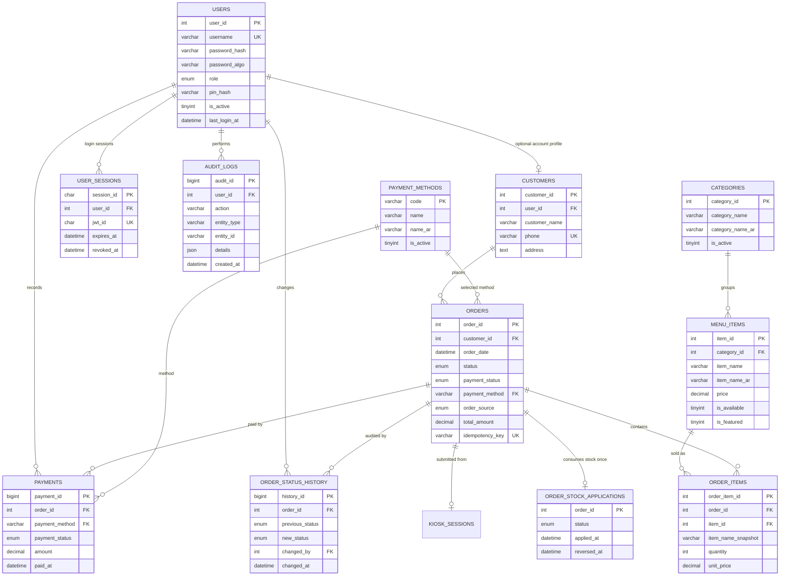
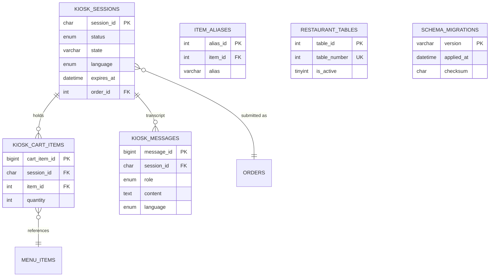

# ER diagrams

The database has **25 tables**. Diagrams are split by domain for readability; a combined Mermaid
source is available at [`database/diagrams/er_diagram.mmd`](../database/diagrams/er_diagram.mmd).
A structure-only SQL snapshot is in [`database/schema.sql`](../database/schema.sql).

---

## 1. Core ordering domain



---

## 2. Inventory and purchasing domain

```mermaid
erDiagram
    SUPPLIERS ||--o{ INGREDIENTS : "default supplier"
    SUPPLIERS ||--o{ PURCHASE_ORDERS : "receives"
    INGREDIENTS ||--|| INVENTORY_STOCK : "current balance"
    INGREDIENTS ||--o{ MENU_ITEM_INGREDIENTS : "used in recipes"
    INGREDIENTS ||--o{ STOCK_MOVEMENTS : "ledger"
    INGREDIENTS ||--o{ PURCHASE_ORDER_ITEMS : "purchased as"

    MENU_ITEMS ||--o{ MENU_ITEM_INGREDIENTS : "recipe lines"
    PURCHASE_ORDERS ||--o{ PURCHASE_ORDER_ITEMS : "lines"
    PURCHASE_ORDERS ||--o{ STOCK_MOVEMENTS : "receiving"
    ORDERS ||--o{ STOCK_MOVEMENTS : "consumption/reversal"
    USERS ||--o{ STOCK_MOVEMENTS : "records"
    USERS ||--o{ INVENTORY_STOCK : "updates"

    SUPPLIERS {
        int supplier_id PK
        varchar supplier_name UK
        varchar phone
        varchar email
        tinyint is_active
    }
    INGREDIENTS {
        int ingredient_id PK
        varchar ingredient_name UK
        varchar ingredient_name_ar
        varchar unit_of_measure
        decimal minimum_stock
        decimal safety_stock
        int lead_time_days
        int default_supplier_id FK
    }
    INVENTORY_STOCK {
        bigint stock_id PK
        int ingredient_id FK_UK
        decimal quantity
        datetime last_updated
        int updated_by FK
    }
    MENU_ITEM_INGREDIENTS {
        bigint menu_item_ingredient_id PK
        int item_id FK
        int ingredient_id FK
        decimal quantity
        varchar unit_of_measure
    }
    STOCK_MOVEMENTS {
        bigint movement_id PK
        int ingredient_id FK
        enum movement_type
        decimal quantity_change
        decimal quantity_after
        int order_id FK
        bigint purchase_order_id FK
        int user_id FK
    }
    PURCHASE_ORDERS {
        bigint purchase_order_id PK
        int supplier_id FK
        enum status
        date expected_date
        decimal total_amount
        int created_by FK
    }
    PURCHASE_ORDER_ITEMS {
        bigint purchase_order_item_id PK
        bigint purchase_order_id FK
        int ingredient_id FK
        decimal quantity_ordered
        decimal quantity_received
        decimal unit_cost
    }
```

---

## 3. Kiosk and helper tables



---

## 4. Relationship summary

| Relationship | Cardinality | Delete rule |
| --- | --- | --- |
| `users` → `customers` | one-to-zero-or-one | SET NULL |
| `customers` → `orders` | one-to-many | restrict |
| `categories` → `menu_items` | one-to-many | restrict |
| `orders` → `order_items` | one-to-many | CASCADE |
| `orders` → `payments` | one-to-many | CASCADE |
| `orders` → `order_status_history` | one-to-many | CASCADE |
| `orders` → `order_stock_applications` | one-to-zero-or-one | CASCADE |
| `orders` → `stock_movements` | one-to-many | SET NULL |
| `orders` → `kiosk_sessions` | one-to-zero-or-one | SET NULL |
| `payment_methods` → `orders/payments` | one-to-many | restrict |
| `ingredients` → `inventory_stock` | one-to-one | CASCADE |
| `ingredients` → `menu_item_ingredients` | one-to-many | CASCADE |
| `ingredients` → `stock_movements` | one-to-many | CASCADE |
| `suppliers` → `purchase_orders` | one-to-many | restrict |
| `purchase_orders` → `purchase_order_items` | one-to-many | CASCADE |
| `kiosk_sessions` → `kiosk_cart_items/messages` | one-to-many | CASCADE |
| `users` → `audit_logs`, sessions, history, movements | one-to-many | SET NULL / CASCADE |

`item_aliases`, `restaurant_tables` and `schema_migrations` are standalone helper/metadata tables.
